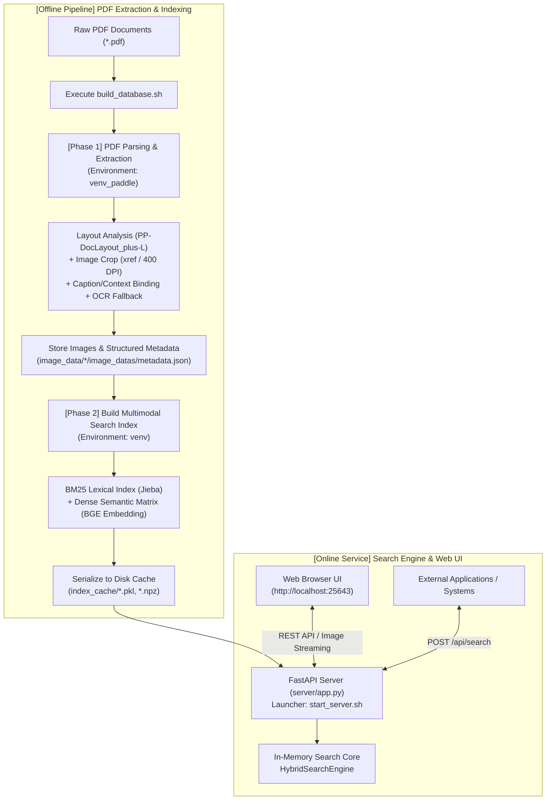
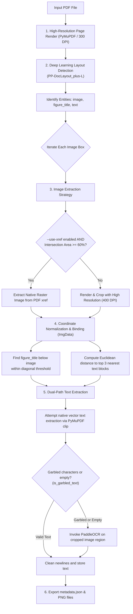
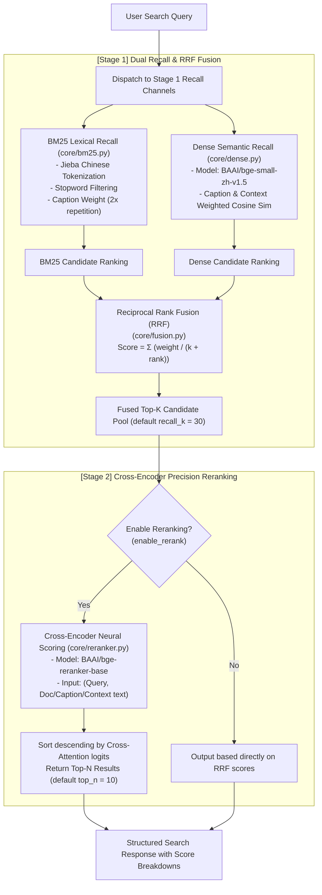

# PDF Image Extractor 2

[繁體中文](README.zh.md) | **English**

A high-performance system for **high-resolution figure extraction** and **multimodal hybrid semantic search** across complex scientific and technical PDF documents.

This project integrates deep learning layout detection, intelligent geometric figure-context binding, dual-path text extraction with automatic OCR fallback, and a two-stage search engine combining **BM25 Lexical Recall + Dense Semantic Vector Retrieval + Reciprocal Rank Fusion (RRF) + Cross-Encoder Precision Neural Reranking**, complete with an intuitive and responsive Web UI.

---

## 📑 Table of Contents

- [1. Key Features](#1-key-features)
- [2. System Architecture & Workflow](#2-system-architecture--workflow)
  - [2.1 End-to-End Workflow Diagram](#21-end-to-end-workflow-diagram)
  - [2.2 Dual-venv Isolation Architecture](#22-dual-venv-isolation-architecture)
- [3. PDF Document Analysis & Extraction](#3-pdf-document-analysis--extraction)
  - [3.1 Analysis Pipeline Flowchart](#31-analysis-pipeline-flowchart)
  - [3.2 Core Technological Capabilities](#32-core-technological-capabilities)
  - [3.3 Extracted Database & Metadata Schema](#33-extracted-database--metadata-schema)
- [4. Multimodal Hybrid Search Engine](#4-multimodal-hybrid-search-engine)
  - [4.1 Two-Stage Retrieval Architecture](#41-two-stage-retrieval-architecture)
  - [4.2 Search Pipeline Principles](#42-search-pipeline-principles)
  - [4.3 Standalone Diagnostic & Debug APIs](#43-standalone-diagnostic--debug-apis)
- [5. Installation & Deployment Guide](#5-installation--deployment-guide)
  - [5.1 Prerequisites](#51-prerequisites)
  - [5.2 Step 1: Set Up Dual Virtual Environments](#52-step-1-set-up-dual-virtual-environments)
  - [5.3 Step 2: Build Database & Generate Indices](#53-step-2-build-database--generate-indices)
  - [5.4 Step 3: Launch Server & Web UI](#54-step-3-launch-server--web-ui)
- [6. Directory Layout & Module Reference](#6-directory-layout--module-reference)
- [7. FAQ & Troubleshooting](#7-faq--troubleshooting)

---

## 1. Key Features

- 🎯 **Deep Learning Layout Analysis**: Powered by PaddleX's `PP-DocLayout_plus-L` model to reliably detect page entities: images, figure titles, text blocks, and bounding boxes.
- 🖼️ **High-Fidelity Figure Extraction**: Direct extraction of native raster bitmaps via PDF object streams (`xref`), with seamless fallback to 400+ DPI high-resolution rendering crops to eliminate compression artifacts.
- 🔗 **Intelligent Figure-Context Association**: Automatically associates each figure with its underlying caption (`figure_title`) and the top 3 nearest explanatory body paragraphs using geometric distance heuristics.
- 🛡️ **Dual-Path Text Extraction & OCR Fallback**: Extracts text cleanly from native PDF vector font layers; automatically falls back to PaddleOCR when encountering garbled characters, CID fonts, or corrupt encodings.
- ⚡ **Two-Stage Hybrid Retrieval Pipeline**:
  - **Stage 1 (Dual Recall & Fusion)**: Jieba + Okapi BM25 keyword recall combined with BGE dense semantic vectors, fused via Reciprocal Rank Fusion (RRF).
  - **Stage 2 (Cross-Attention Reranking)**: Precision neural reranking using `BAAI/bge-reranker-base` to cross-examine top candidate documents.
- 🧩 **Dual Virtual Environment Isolation**: Separate Python virtual environments (`venv_paddle` vs `venv`) guarantee zero GPU CUDA context collisions between PaddlePaddle and PyTorch.
- 🖥️ **Integrated Web UI & RESTful API**: Production-ready FastAPI service featuring a responsive web dashboard, real-time search scoring breakdowns, thumbnail previews, and image streaming.

---

## 2. System Architecture & Workflow

The system operates across two main lifecycles: **Offline Database Ingestion & Indexing** and **Online Query Serving**.

### 2.1 End-to-End Workflow Diagram



### 2.2 Dual-venv Isolation Architecture

When running complex AI pipelines, loading PaddlePaddle (Baidu Paddle) and PyTorch / HuggingFace Transformers within the same Python process often results in CUDA memory allocator conflicts, cuDNN mismatch crashes, or segmentation faults.

This repository enforces **complete architectural isolation**:
1. **`venv_paddle`** (Extraction Environment): Packages `paddlepaddle-gpu`, `paddleocr`, `paddlex`, `PyMuPDF`, and `opencv-python`. Dedicated to layout detection, image cropping, xref decoding, and OCR. The process terminates immediately upon completion, releasing all GPU resources cleanly.
2. **`venv`** (Search & Server Environment): Packages `torch`, `sentence-transformers` (`BAAI/bge-small-zh-v1.5`, `BAAI/bge-reranker-base`), `rank-bm25`, `jieba`, `fastapi`, and `uvicorn`. Dedicated to vector matrix indexing and low-latency server operations.

---

## 3. PDF Document Analysis & Extraction

PDF analysis is orchestrated by [build_database.py](build_database.py) calling the `PdfInfo` pipeline in [core/converter/__init__.py](core/converter/__init__.py).

### 3.1 Analysis Pipeline Flowchart



### 3.2 Core Technological Capabilities

1. **High-Resolution Page Rendering & Layout Detection**:
   - Uses [PyMuPDF (fitz)](core/converter/__init__.py) to render pages at 300 DPI.
   - Applies the `PP-DocLayout_plus-L` model via PaddleX to accurately segment each page into `image`, `figure_title`, and `text` bounding boxes.

2. **Smart Image Extraction with `xref` Prioritization**:
   - Instead of standard lossy viewport screenshotting, `--use-xref` checks the spatial overlap between the layout bounding box and internal PDF bitmap streams.
   - If coverage $\ge 60\%$, the original image stream is directly extracted via `pdf_doc.extract_image(xref)` without re-encoding quality loss.
   - If the image is a vector graphic or composite diagram, the pipeline automatically falls back to an ultra-crisp crop rendered at `--optimize-dpi 400`.

3. **Coordinate Calibration & Figure-Context Binding**:
   - The [core/converter/tools/coordinates.py](core/converter/tools/coordinates.py) module (`map_bbox`) converts coordinates between rendering raster pixels and native PDF point geometries.
   - The [core/converter/distance.py](core/converter/distance.py) module computes relative distances:
     - **Figure Caption (`figure_title`)**: Identified dynamically based on proximity below the figure bounded by an adaptive percentage of the figure's diagonal.
     - **Context Paragraphs (`surrounding_texts`)**: Gathers the 3 closest text blocks by Euclidean distance to capture contextual discussions.

4. **Dual-Path Text Extraction with Automatic OCR Fallback**:
   - Implemented across [core/converter/img_data.py](core/converter/img_data.py) and [core/converter/tools/text_validation.py](core/converter/tools/text_validation.py).
   - Fast PyMuPDF vector text extraction is attempted first.
   - If extracted text contains encoding corruption (e.g. `(cid:xxx)` tags or mojibake detected by `is_garbled_text`), [core/converter/img2text.py](core/converter/img2text.py) automatically triggers `PaddleOCR` on the visual image patch.

### 3.3 Extracted Database & Metadata Schema

Processed documents are organized in `image_data/`:

```text
image_data/
├── <pdf_uid>/                         # Unique identifier UID for each document
│   └── image_datas/
│       ├── image_0000.png             # Extracted high-resolution image
│       ├── image_0001.png
│       └── metadata.json              # Geometry, caption, and surrounding text
└── processed_docs.json                # Progress log for resume support
```

#### Sample `metadata.json`:
```json
{
  "name": "agriculture_tech_docs/report_2024.pdf",
  "uid": "a1b2c3d4e5f6",
  "imgs": [
    {
      "name": "image_0000",
      "page": 3,
      "coordinate": [120, 245, 890, 710],
      "figure_title": "Figure 3: Root growth comparison across fertilizer treatments",
      "surrounding_texts": [
        "Results show treatment group significantly outperformed control in root elongation...",
        "As illustrated in Figure 3, lateral branch density increased by 35% on Day 45...",
        "Soil rhizosphere analysis confirmed enhanced microbial activity."
      ]
    }
  ]
}
```

---

## 4. Multimodal Hybrid Search Engine

The retrieval engine is implemented in [core/engine.py](core/engine.py) (`HybridSearchEngine`), unifying lexical matching, semantic vector similarity, and deep cross-attention reranking.

### 4.1 Two-Stage Retrieval Architecture



### 4.2 Search Pipeline Principles

1. **Stage 1A: Sparse Lexical Recall (BM25)**
   - Modules: [core/bm25.py](core/bm25.py) and [core/tokenizer.py](core/tokenizer.py).
   - Jieba tokenizer segments Chinese terms while filtering punctuation and noise.
   - During index fitting, captions are repeated (`caption_repeat=2`) to boost lexical hits in titles.

2. **Stage 1B: Dense Semantic Vector Recall (BGE Embeddings)**
   - Modules: [core/dense.py](core/dense.py) and [core/model_manager.py](core/model_manager.py).
   - Utilizes `BAAI/bge-small-zh-v1.5` (512 dimensions).
   - Precomputes separate embedding matrices for captions and surrounding context, scoring candidates dynamically (`caption_weight=2.0, context_weight=1.0`).

3. **Stage 1C: Reciprocal Rank Fusion (RRF)**
   - Module: [core/fusion.py](core/fusion.py).
   - Formula:
     $$	ext{RRF Score}(d) = rac{w_{	ext{bm25}}}{k + 	ext{rank}_{	ext{bm25}}(d)} + rac{w_{	ext{dense}}}{k + 	ext{rank}_{	ext{dense}}(d)}$$
   - Default constant $k = 60$. RRF eliminates scale variance between lexical and embedding score ranges, producing a high-recall candidate pool.

4. **Stage 2: Cross-Encoder Precision Neural Reranking**
   - Module: [core/reranker.py](core/reranker.py).
   - Uses `BAAI/bge-reranker-base`.
   - Computes full cross-attention between `(Query, "Document: {doc_name} | Caption: {figure_title} | Context: {surrounding_text}")`.
   - Produces fine-grained relevance logits to promote the most contextually relevant figures to the top.

### 4.3 Standalone Diagnostic & Debug APIs

Diagnostic endpoints enable targeted debugging for each stage:
- `POST /api/debug/tokenize?text=...`: Inspect tokenization and filtered terms.
- `POST /api/debug/bm25?query=...`: Test isolated lexical scoring and term matches.
- `POST /api/debug/dense?query=...`: Test isolated vector cosine similarity scores.
- `POST /api/debug/rerank`: Test Cross-Encoder scoring on arbitrary query-document pairs.

---

## 5. Installation & Deployment Guide

### 5.1 Prerequisites

- **OS**: Linux (Ubuntu 20.04 / 22.04 LTS recommended)
- **Python**: Python 3.10 or 3.12 (via `python3-venv`)
- **Hardware**:
  - NVIDIA GPU (8GB+ VRAM, CUDA 11.8+ or CUDA 12+)
  - CPU execution is fully supported via the `--cpu` flag.
- **Tools**: `tmux` (for background service daemon), `git`

---

### 5.2 Step 1: Set Up Dual Virtual Environments

From the repository root, create the two isolated virtual environments:

```bash
cd /home/tseng/external/pdf-image-extractor-2

# 1. Setup PDF extraction environment (venv_paddle)
python3 -m venv venv_paddle
./venv_paddle/bin/pip install --upgrade pip
./venv_paddle/bin/pip install -r requirements.paddle.txt

# 2. Setup Search & Server environment (venv)
python3 -m venv venv
./venv/bin/pip install --upgrade pip
./venv/bin/pip install -r requirements.txt fastapi uvicorn
```

---

### 5.3 Step 2: Build Database & Generate Indices

Execute the unified [build_database.sh](build_database.sh) script to perform **PDF image extraction** followed by **search index generation**:

```bash
# Basic syntax: ./build_database.sh <raw_pdf_directory> [output_directory]
./build_database.sh ./test_pdfs
```

#### CLI Reference:

| Argument / Option | Type | Default | Description |
| :--- | :--- | :--- | :--- |
| `<raw_pdf_directory>` | Positional | *(Required)* | Directory with source PDF files (searches recursively) |
| `[output_directory]` | Positional | `./image_data` | Directory where extracted images and metadata are stored |
| `-s, --source <dir>` | Option | None | Source PDF directory (alternative to positional argument) |
| `-o, --output <dir>` | Option | `./image_data` | Output directory |
| `-c, --cache <dir>` | Option | `./index_cache`| Index cache directory for vector and BM25 pickles |
| `-l, --limit <n>` | Option | None | Maximum number of PDFs to process (for quick testing) |
| `--dpi <n>` | Option | `300` | PDF page rendering DPI for layout detection |
| `--optimize-dpi <n>` | Option | `400` | High-resolution image crop rendering DPI |
| `--use-xref` | Flag | Off | Prioritize native raster bitmap extraction via PDF xref |
| `--cpu` | Flag | Prefers GPU | Force CPU execution for layout detection and OCR |
| `--skip-extract` | Flag | Off | Skip image extraction; only rebuild search index |
| `--skip-index` | Flag | Off | Only extract images and text; skip search indexing |

#### Usage Examples:

```bash
# Example A: Extract with native xref image extraction enabled
./build_database.sh ./test_pdfs --use-xref

# Example B: Quick test run on the first 5 PDFs
./build_database.sh ./test_pdfs --limit 5

# Example C: Rebuild search indices on existing extracted data
./build_database.sh ./test_pdfs --skip-extract
```

#### Checkpointing & Resume Support
- Progress is logged atomically to `<output_dir>/processed_docs.json`.
- Safely interrupt at any time with `Ctrl+C`. Re-running the script will **automatically skip already completed files**.

---

### 5.4 Step 3: Launch Server & Web UI

#### Option A: Managed Background Daemon (Recommended)

The [start_server.sh](start_server.sh) script launches the FastAPI server inside a persistent `tmux` session on port `25643`:

```bash
./start_server.sh
```

- Automatically frees port 25643 if occupied and restarts cleanly.
- To inspect live server logs:
  ```bash
  tmux attach -t pdf-image-extractor-2
  # To detach without stopping the server, press: Ctrl + B then D
  ```

#### Option B: Foreground Dev Server

```bash
export IMAGE_DATA_DIR="./image_data"
export CACHE_DIR="./index_cache"
source venv/bin/activate
uvicorn server.app:app --host 0.0.0.0 --port 25643 --reload
```

#### Accessing Services:
- 🌐 **Interactive Web UI**: [http://localhost:25643](http://localhost:25643)
- 📚 **Swagger Interactive API Docs**: [http://localhost:25643/docs](http://localhost:25643/docs)
- 🔍 **ReDoc Documentation**: [http://localhost:25643/redoc](http://localhost:25643/redoc)

---

## 6. Directory Layout & Module Reference

```text
pdf-image-extractor-2/
├── README.md                           # English documentation (this file)
├── README.zh.md                        # Traditional Chinese documentation
├── build_database.sh                   # Unified extraction & indexing runner
├── build_database.py                   # PDF extraction & layout processing CLI
├── start_server.sh                     # Backend launcher & tmux daemon script
├── requirements.txt                    # Search engine & FastAPI dependencies
├── requirements.paddle.txt             # PaddleOCR & layout analysis dependencies
│
├── core/                               # Core algorithms and neural models
│   ├── __init__.py                     # Package exports
│   ├── models.py                       # Pydantic schemas (ImageDocument, SearchQuery, etc.)
│   ├── model_manager.py                # Thread-safe Singleton model loader (BGE & Reranker)
│   ├── tokenizer.py                    # Jieba Chinese tokenizer & stopword filtering
│   ├── data_loader.py                  # Dataset scanner & metadata.json parser
│   ├── bm25.py                         # BM25 sparse retriever & cache serializer
│   ├── dense.py                        # Dense vector retriever (BGE Bi-Encoder)
│   ├── reranker.py                     # Cross-Encoder neural reranker
│   ├── fusion.py                       # Reciprocal Rank Fusion (RRF) algorithm
│   ├── engine.py                       # HybridSearchEngine orchestrating the pipeline
│   ├── index_builder.py                # Standalone CLI index builder
│   │
│   └── converter/                      # PDF document parsing & vision extraction
│       ├── __init__.py                 # PdfInfo: Page rendering, layout discovery & export
│       ├── img_data.py                 # ImgData: Bounding box mapping & context extraction
│       ├── img2text.py                 # ImgOcr: PaddleOCR optical character recognition
│       ├── distance.py                 # Geometric box distance & diagonal calculations
│       └── tools/
│           ├── coordinates.py          # Coordinate mapping across resolutions
│           ├── text_validation.py      # Garbled text & encoding validation
│           └── random_uid.py           # Unique identifier generator
│
├── server/                             # FastAPI application backend
│   ├── __init__.py
│   └── app.py                          # REST API endpoints, image streaming & static mount
│
├── web/                                # Web frontend assets
│   ├── index.html                      # Single-page application HTML
│   ├── style.css                       # Responsive UI styles
│   └── app.js                          # Search requests, score displays & modal preview
│
├── test_pdfs/                          # Sample PDF documents directory
├── image_data/                         # Extracted images and metadata directory
└── index_cache/                        # Serialized search index cache (.pkl, .npz)
```

---

## 7. FAQ & Troubleshooting

### Q1: Why is the first query slightly slower?
**Cause**: Neural weights (`BAAI/bge-small-zh-v1.5` and `BAAI/bge-reranker-base`) need to be loaded into GPU memory.  
**Solution**: [server/app.py](server/app.py) preloads models in the application `lifespan` handler via `default_model_manager.preload_all()`. Once ready, queries run in milliseconds.

### Q2: CUDA Out-of-Memory (OOM) during PDF extraction?
**Cause**: High rendering resolution combined with deep neural layout models on large documents.  
**Solution**:
- Pass `--cpu` to [build_database.sh](build_database.sh) to execute layout detection on CPU.
- Lower the rendering resolution, e.g. `--dpi 200`.

### Q3: Why are certain Chinese domain terms not matching in BM25?
**Cause**: Specialized agricultural or botanical vocabulary split into sub-tokens by default Jieba dictionaries.  
**Solution**: Add custom terms using `tokenizer.add_word(...)` in [core/tokenizer.py](core/tokenizer.py), or inspect tokenization via `POST /api/debug/tokenize`.

### Q4: How do I switch PDF source directories or outputs?
Pass custom paths directly into the build script:
```bash
./build_database.sh /path/to/my_pdfs /path/to/my_output
```
The script will automatically update the `./image_data` and `./index_cache` symlinks so that [start_server.sh](start_server.sh) continues to function seamlessly.
