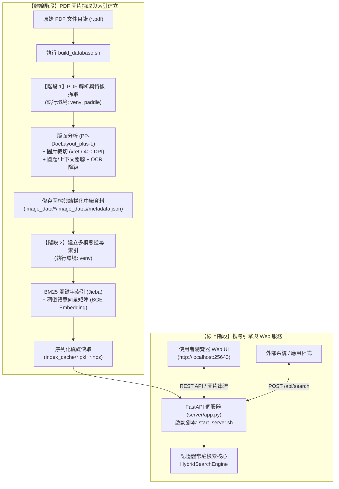
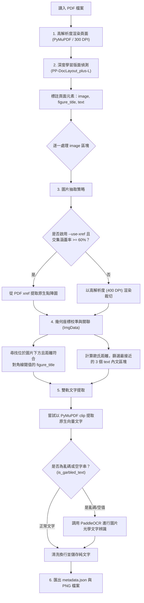
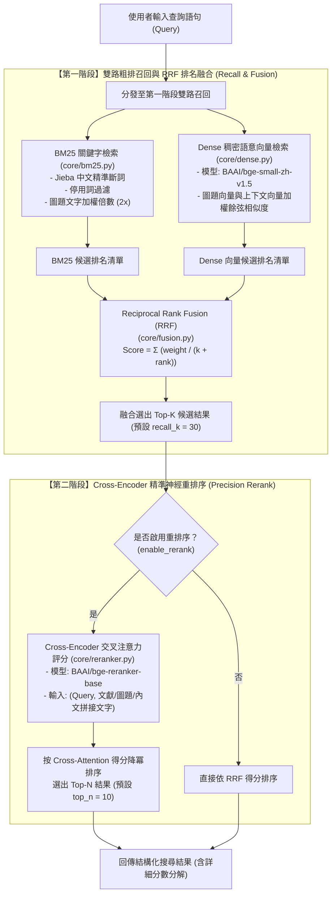

# PDF Image Extractor 2

**繁體中文** | [English](README.md)

一套專為複雜 PDF 文件打造的**高解析度圖表抽取**與**多模態混合語意搜尋系統**。

本專案整合了深度學習版面偵測（Layout Detection）、智慧圖文關聯配對、雙軌文字抽取與 OCR 容錯機制，並提供具備 **BM25 關鍵字檢索 + Dense 稠密向量檢索 + RRF 排名融合 + Cross-Encoder 精準神經重排序** 的兩階段搜尋引擎與直覺流暢的 Web 視覺化互動介面。

---

## 📑 目錄

- [一、核心特色](#一核心特色)
- [二、系統整體架構與運作流程](#二系統整體架構與運作流程)
  - [2.1 系統運作流程圖](#21-系統運作流程圖)
  - [2.2 雙虛擬環境（Dual-venv）隔離架構](#22-雙虛擬環境dual-venv隔離架構)
- [三、PDF 文件分析與圖片抽取方式](#三pdf-文件分析與圖片抽取方式)
  - [3.1 分析處理流程圖](#31-分析處理流程圖)
  - [3.2 關鍵技術剖析](#32-關鍵技術剖析)
  - [3.3 產出資料庫與中繼資料結構](#33-產出資料庫與中繼資料結構)
- [四、多模態混合搜尋機制](#四多模態混合搜尋機制)
  - [4.1 兩階段檢索架構圖](#41-兩階段檢索架構圖)
  - [4.2 檢索管線原理](#42-檢索管線原理)
  - [4.3 獨立診斷與除錯 API](#43-獨立診斷與除錯-api)
- [五、環境建置與佈署指南](#五環境建置與佈署指南)
  - [5.1 系統需求](#51-系統需求)
  - [5.2 步驟 1：建立雙虛擬環境](#52-步驟-1建立雙虛擬環境)
  - [5.3 步驟 2：執行資料庫建置腳本](#53-步驟-2執行資料庫建置腳本)
  - [5.4 步驟 3：啟動伺服器與 Web UI](#54-步驟-3啟動伺服器與-web-ui)
- [六、專案目錄結構](#六專案目錄結構)
- [七、常見問題與疑難排解](#七常見問題與疑難排解)

---

## 一、核心特色

- 🎯 **深度學習版面分析**：基於 PaddleX 的 `PP-DocLayout_plus-L` 模型，精確識別 PDF 頁面中的圖片（image）、圖題（figure_title）、文字段落（text）與邊界座標。
- 🖼️ **高保真圖片抽取**：支援直接從 PDF 物件流（`xref`）抽取原始點陣圖，若無內嵌物件則無縫切換為 400+ DPI 高解析度渲染裁切，杜絕二次失真。
- 🔗 **智慧幾何圖文配對**：動態依據圖片對角線比例與歐氏幾何距離，自動鎖定周圍最相關的圖題與鄰近 3 個內文段落，建立豐富的圖文多模態關聯。
- 🛡️ **雙軌文字提取與亂碼自動降級**：優先以 PyMuPDF 向量層抽取內文（高速度且字形無損）；當遭遇特殊字型或亂碼（CID 字型）時，自動調用 PaddleOCR 進行影像光學辨識補全。
- ⚡ **兩階段混合檢索管線**：
  - **第一階段（雙路召回與融合）**：Jieba + Okapi BM25 關鍵字召回與 BGE 語意向量召回，透過 Reciprocal Rank Fusion (RRF) 進行動態排名融合。
  - **第二階段（交叉注意力精準重排）**：調用 Cross-Encoder 神經模型（`BAAI/bge-reranker-base`）對候選圖文進行深層交叉評分。
- 🧩 **雙虛擬環境隔離（Zero GPU Conflict）**：將 PaddleOCR 與 PyTorch/Transformers 執行時完全切開為獨立行程與虛擬環境，徹底杜絕 CUDA 上下文衝突與記憶體洩漏。
- 🖥️ **一體化 Web 介面與 RESTful API**：內建 FastAPI 伺服器與現代化 Web UI，支援即時關鍵字搜尋、分數診斷分解、縮圖預覽與圖片串流。

---

## 二、系統整體架構與運作流程

整體系統運作劃分為兩大生命週期：**「離線建庫與特徵索引」** 與 **「線上查詢與 API 服務」**。

### 2.1 系統運作流程圖



### 2.2 雙虛擬環境（Dual-venv）隔離架構

在深度學習開發中，PaddlePaddle（百度飛槳）與 PyTorch / HuggingFace Transformers 同時在同一個 Python 行程中載入時，極易因底層 CUDA 執行時、cuDNN 版本或記憶體分配器（Allocator）搶佔而導致 GPU 崩潰（常見為 CUDA Illegal Memory Access 或 OOM）。

為此，本專案在架構層面採用**完全隔離策略**：
1. **`venv_paddle`**（擷取專用環境）：包含 `paddlepaddle-gpu`、`paddleocr`、`paddlex`、`PyMuPDF`、`opencv-python`。專責處理版面分析、圖片裁切、xref 讀取與 OCR。工作完成後行程自動退出，徹底釋放 GPU CUDA 資源。
2. **`venv`**（檢索與伺服器專用環境）：包含 `torch`、`sentence-transformers` (`BAAI/bge-small-zh-v1.5`、`BAAI/bge-reranker-base`)、`rank-bm25`、`jieba`、`fastapi`、`uvicorn`。專責建立混合檢索索引與伺服器長期運行。

---

## 三、PDF 文件分析與圖片抽取方式

PDF 文件分析與圖表抽取由主程式 [build_database.py](build_database.py) 呼叫 [core/converter/__init__.py](core/converter/__init__.py) 的 `PdfInfo` 模組執行。

### 3.1 分析處理流程圖



### 3.2 關鍵技術剖析

1. **高解析度渲染與版面分析**：
   - 使用 [PyMuPDF (fitz)](core/converter/__init__.py) 讀取頁面，先以 300 DPI 渲染為點陣圖像。
   - 透過 PaddleX 載入 `PP-DocLayout_plus-L` 模型進行版面識別，精準圈出每一頁上的圖片範圍、圖題範圍與內文文字方塊。

2. **智慧圖片抽取（`use_xref` 優先機制）**：
   - 傳統方案直接截圖會導致圖片二次壓縮或模糊。本系統提供 `--use-xref` 選項：系統會計算版面偵測方框與 PDF 內部原始點陣圖物件的交集比例（Coverage）。
   - 若重疊涵蓋率 $\ge 60\%$，直接呼叫 `pdf_doc.extract_image(xref)` 提取原圖，獲得 100% 無失真像素。
   - 若為向量組合圖或無獨立點陣物件，則自動降級為 `--optimize-dpi 400`（或自訂 DPI）進行局部無損高解析度裁切。

3. **幾何座標校準與圖文關係關聯**：
   - 座標系統在不同渲染 DPI 與 PDF 原始 points 之間透過 [core/converter/tools/coordinates.py](core/converter/tools/coordinates.py) 的 `map_bbox` 進行雙向換算。
   - 透過 [core/converter/distance.py](core/converter/distance.py) 計算方框距離：
     - **圖題（Figure Title）**：依據圖片對角線長度計算動態閾值，鎖定距離圖片最近且合理的圖題標籤。
     - **周圍內文（Surrounding Texts）**：排序距離圖片最近的 3 個文字區塊，擷取圖表關聯的說明段落。

4. **雙軌文字提取與亂碼自動 OCR 降級**：
   - 由 [core/converter/img_data.py](core/converter/img_data.py) 與 [core/converter/tools/text_validation.py](core/converter/tools/text_validation.py) 協同作業。
   - PDF 常常遇到嵌入字型損毀或內建編碼缺失，導致直接複製文字時產生亂碼（例如常見的 `(cid:xxx)` 或無法解析的符號）。
   - 系統在提取文字後會經由 `is_garbled_text()` 驗證；一旦判定為亂碼或空文字，即刻啟動 [core/converter/img2text.py](core/converter/img2text.py) 中的 `PaddleOCR` 對該區域進行光學字符識別，確保文字內容完整可靠。

### 3.3 產出資料庫與中繼資料結構

處理後的資料庫預設存放於 `image_data/`：

```text
image_data/
├── <pdf_uid>/                         # 每份 PDF 文件的唯一識別碼 UID
│   └── image_datas/
│       ├── image_0000.png             # 抽取出的高畫質圖片
│       ├── image_0001.png
│       └── metadata.json              # 該文檔所有圖片的幾何座標與圖文關聯資訊
└── processed_docs.json                # 已完成處理的 PDF 清單（斷點續傳記錄）
```

#### `metadata.json` 範例結構：
```json
{
  "name": "agriculture_tech_docs/report_2024.pdf",
  "uid": "a1b2c3d4e5f6",
  "imgs": [
    {
      "name": "image_0000",
      "page": 3,
      "coordinate": [120, 245, 890, 710],
      "figure_title": "圖 3：不同施肥處理下作物根系生長對比圖",
      "surrounding_texts": [
        "試驗結果顯示，處理組在根長與地下生物量上顯著優於對照組...",
        "如圖 3 所示，在第 45 天觀測時，側根分枝密度增加了 35%...",
        "土壤環境分析進一步證實了微生物活性的提升。"
      ]
    }
  ]
}
```

---

## 四、多模態混合搜尋機制

搜尋核心由 [core/engine.py](core/engine.py) 的 `HybridSearchEngine` 主導，整合稀疏檢索、語意向量與交叉注意力重排序。

### 4.1 兩階段檢索架構圖



### 4.2 檢索管線原理

1. **Stage 1A: 稀疏關鍵字召回（BM25）**
   - 模組：[core/bm25.py](core/bm25.py) 與 [core/tokenizer.py](core/tokenizer.py)。
   - 使用 Jieba 進行中文斷詞，去除標點與停用詞。
   - 建立索引時，圖題文字會以雙倍頻率加權（`caption_repeat=2`），確保命中標題關鍵字的文件獲得更高的相關性權重。

2. **Stage 1B: 稠密向量召回（Dense Embedding）**
   - 模組：[core/dense.py](core/dense.py) 與 [core/model_manager.py](core/model_manager.py)。
   - 使用輕量且強大的中英雙語模型 `BAAI/bge-small-zh-v1.5`（512 維度）。
   - 分別對「圖題文字」與「多個周圍上下文文字」預先計算向量嵌入。
   - 查詢時分別計算相似度並進行動態加權（預設 `caption_weight=2.0, context_weight=1.0`），彌補單純關鍵字字面匹配無法涵蓋同義詞的不足。

3. **Stage 1C: Reciprocal Rank Fusion (RRF 排名融合)**
   - 模組：[core/fusion.py](core/fusion.py)。
   - 公式：
     $$	ext{RRF Score}(d) = rac{w_{	ext{bm25}}}{k + 	ext{rank}_{	ext{bm25}}(d)} + rac{w_{	ext{dense}}}{k + 	ext{rank}_{	ext{dense}}(d)}$$
   - 預設常數 $k = 60$。RRF 避免了不同打分算法量綱不一致的問題，兼具關鍵字精準命中與語意泛化召回能力。

4. **Stage 2: 交叉注意力精準重排序（Cross-Encoder Reranker）**
   - 模組：[core/reranker.py](core/reranker.py)。
   - 使用神經重排模型 `BAAI/bge-reranker-base`。
   - 針對第一階段召回的候選文檔（例如 Top-30），將查詢語句與組合文本（`文獻: {doc_name} | 圖題: {figure_title} | 內文: {surrounding_text}`）一同輸入模型中計算 Cross-Attention。
   - 提供細粒度的語意對齊評分，將真正最吻合使用者意圖的圖表推至最前方。

### 4.3 獨立診斷與除錯 API

所有檢索模組均具備單獨測試與診斷端點，便於排查問題：
- `POST /api/debug/tokenize?text=...`：檢查 Jieba 分詞結果與過濾字詞。
- `POST /api/debug/bm25?query=...`：單獨檢視 BM25 檢索得分與命中關鍵詞。
- `POST /api/debug/dense?query=...`：單獨測試語意向量相似度得分。
- `POST /api/debug/rerank`：傳入 Query 與候選文本清單，測試 Cross-Encoder 評分。

---

## 五、環境建置與佈署指南

### 5.1 系統需求

- **作業系統**：Linux (Ubuntu 20.04 / 22.04 推薦)
- **Python 版本**：Python 3.10 或 3.12 (建議使用 python3-venv)
- **硬體建議**：
  - NVIDIA GPU（顯存 8GB 以上，支援 CUDA 11.8+ 或 CUDA 12+）
  - 若無 GPU，亦可加上 `--cpu` 參數以 CPU 運行。
- **系統工具**：`tmux`（用於背景服務管理）、`git`

---

### 5.2 步驟 1：建立雙虛擬環境

進入專案根目錄後，建立兩個隔離的虛擬環境：

```bash
cd /home/tseng/external/pdf-image-extractor-2

# 1. 建立並安裝 PDF 擷取專用環境 (venv_paddle)
python3 -m venv venv_paddle
./venv_paddle/bin/pip install --upgrade pip
./venv_paddle/bin/pip install -r requirements.paddle.txt

# 2. 建立並安裝 搜尋與伺服器專用環境 (venv)
python3 -m venv venv
./venv/bin/pip install --upgrade pip
./venv/bin/pip install -r requirements.txt fastapi uvicorn
```

> [!NOTE]
> `requirements.paddle.txt` 會自動由 Paddle 官方渠道下載對應 CUDA 版本的預編譯套件，大幅降低手動編譯相依性的困難。

---

### 5.3 步驟 2：執行資料庫建置腳本

使用封裝好的 [build_database.sh](build_database.sh) 腳本，一鍵完成 **PDF 圖文擷取** 與 **檢索索引建置**：

```bash
# 基本語法: ./build_database.sh <原始_PDF_目錄> [輸出目錄]
./build_database.sh ./test_pdfs
```

#### 常用參數與選項說明：

| 參數 / 選項 | 類型 | 預設值 | 說明 |
| :--- | :--- | :--- | :--- |
| `<原始_PDF_目錄>` | 位置參數 | *(必要)* | 存放欲分析 PDF 的目錄（自動遞迴搜尋所有 `.pdf`） |
| `[輸出目錄]` | 位置參數 | `./image_data` | 擷取圖片與 metadata 儲存位置 |
| `-s, --source <dir>` | 選項 | 無 | 指定原始 PDF 目錄（可替代位置參數） |
| `-o, --output <dir>` | 選項 | `./image_data` | 指定輸出目錄 |
| `-c, --cache <dir>` | 選項 | `./index_cache`| 指定向量與 BM25 索引快取目錄 |
| `-l, --limit <n>` | 選項 | 無限制 | 限制最多處理 $n$ 份文件（可用於快速小規模測試） |
| `--dpi <n>` | 選項 | `300` | PDF 頁面轉圖像檢測 DPI |
| `--optimize-dpi <n>` | 選項 | `400` | 圖片局部裁切與優化解析度 DPI |
| `--use-xref` | 旗標 | 關閉 | 優先使用 PDF 原生點陣圖流（`xref`）抽取無損圖 |
| `--cpu` | 旗標 | 優先 GPU | 強制使用 CPU 執行版面分析與 OCR |
| `--skip-extract` | 旗標 | 關閉 | 跳過 PDF 圖片擷取，僅對現有目錄重建搜尋索引 |
| `--skip-index` | 旗標 | 關閉 | 僅擷取圖片與文字，跳過向量與 BM25 索引建立 |

#### 常用範例：

```bash
# 範例 A：處理 test_pdfs 目錄並啟用 xref 原生點陣圖抽取
./build_database.sh ./test_pdfs --use-xref

# 範例 B：快速測試前 5 篇文檔
./build_database.sh ./test_pdfs --limit 5

# 範例 C：已擷取過圖片，僅重新訓練/更新搜尋向量索引
./build_database.sh ./test_pdfs --skip-extract
```

#### 斷點續傳機制
- 腳本在處理每一份文件時，會自動將相對路徑記錄至 `<輸出目錄>/processed_docs.json`。
- 支援隨時按下 `Ctrl+C` 安全中斷，系統會儲存當前進度並釋放暫存檔案。再次執行相同命令時將**自動跳過已完成的文檔**。

---

### 5.4 步驟 3：啟動伺服器與 Web UI

#### 方式 A：透過管理腳本啟動（推薦）

專案內建 [start_server.sh](start_server.sh)，透過 `tmux` 在背景安全維護服務行程，並自動監聽埠號 `25643`：

```bash
./start_server.sh
```

- 若原有服務正在執行，腳本會自動釋放該埠號並重啟。
- 啟動後可使用下列指令檢視即時日誌：
  ```bash
  tmux attach -t pdf-image-extractor-2
  # 退出 tmux 檢視請按: Ctrl + B 然後按 D
  ```

#### 方式 B：直接於前景啟動（開發偵錯用）

```bash
export IMAGE_DATA_DIR="./image_data"
export CACHE_DIR="./index_cache"
source venv/bin/activate
uvicorn server.app:app --host 0.0.0.0 --port 25643 --reload
```

#### 存取服務：
- 🌐 **Web 視覺化搜尋介面**：開啟瀏覽器造訪 [http://localhost:25643](http://localhost:25643)
- 📚 **Swagger 互動式 API 文檔**：[http://localhost:25643/docs](http://localhost:25643/docs)
- 🔍 **ReDoc 文檔**：[http://localhost:25643/redoc](http://localhost:25643/redoc)

---

## 六、專案目錄結構

```text
pdf-image-extractor-2/
├── README.md                           # 英文版說明文件
├── README.zh.md                        # 繁體中文版說明文件 (本文件)
├── build_database.sh                   # 資料庫與索引建置一鍵執行腳本
├── build_database.py                   # PDF 圖文抽取與版面解析主程式
├── start_server.sh                     # 後端伺服器 tmux 守護與啟動腳本
├── requirements.txt                    # 搜尋引擎與伺服器相依清單
├── requirements.paddle.txt             # PaddleOCR 與版面分析專用相依清單
│
├── core/                               # 核心演算法與模型模組
│   ├── __init__.py                     # 模組導出
│   ├── models.py                       # Pydantic 資料模型結構定義
│   ├── model_manager.py                # 深度學習模型單例管理 (BGE & Reranker)
│   ├── tokenizer.py                    # Jieba 斷詞器與停用詞過濾
│   ├── data_loader.py                  # 結構化資料集與 metadata.json 讀取器
│   ├── bm25.py                         # BM25 稀疏檢索器與序列化快取
│   ├── dense.py                        # Dense 語意向量檢索器 (BGE Bi-Encoder)
│   ├── reranker.py                     # Cross-Encoder 神經重排序器
│   ├── fusion.py                       # Reciprocal Rank Fusion (RRF) 算法
│   ├── engine.py                       # 兩階段混合檢索排程引擎 (HybridSearchEngine)
│   ├── index_builder.py                # 離線搜尋索引建立 CLI 工具
│   │
│   └── converter/                      # PDF 解析與影像抽取核心
│       ├── __init__.py                 # PdfInfo: 版面偵測、頁面渲染與匯出
│       ├── img_data.py                 # ImgData: 圖文幾何關聯、圖題配對
│       ├── img2text.py                 # ImgOcr: PaddleOCR 光學字元辨識
│       ├── distance.py                 # 幾何方框距離與對角線計算
│       └── tools/
│           ├── coordinates.py          # 跨 DPI 與 PDF 原始解析度座標對齊
│           ├── text_validation.py      # 亂碼與損毀字型檢測工具
│           └── random_uid.py           # 隨機唯一識別碼生成器
│
├── server/                             # FastAPI 後端伺服器
│   ├── __init__.py
│   └── app.py                          # REST API 端點、圖片串流與靜態 Web 掛載
│
├── web/                                # 前端 Web 互動介面
│   ├── index.html                      # 現代化單頁 UI 結構
│   ├── style.css                       # 樣式定義
│   └── app.js                          # 搜尋請求發送、參數調節與縮圖渲染
│
├── test_pdfs/                          # 測試用原始 PDF 文檔存放目錄
├── image_data/                         # 抽取結果儲存目錄 (圖檔與 metadata.json)
└── index_cache/                        # 搜尋索引持久化快取目錄 (.pkl, .npz)
```

---

## 七、常見問題與疑難排解

### Q1: 啟動第一次查詢時耗時較長？
**原因**：神經模型權重（`BAAI/bge-small-zh-v1.5` 與 `BAAI/bge-reranker-base`）在初次被呼叫時需從 HuggingFace 快取載入至顯存。  
**解決方式**：[server/app.py](server/app.py) 已在伺服器啟動生命週期（`lifespan`）中配置 `default_model_manager.preload_all()` 進行預先載入，服務啟動完成後的查詢均可在毫秒級至數十毫秒內完成。

### Q2: 執行 PDF 擷取時出現 CUDA 顯存不足（OOM）？
**原因**：大型文檔高解析度渲染或並行處理佔用過多顯存。  
**解決方式**：
- 在 [build_database.sh](build_database.sh) 中加入 `--cpu` 參數，改用 CPU 執行版面分析與 OCR。
- 降低頁面渲染解析度，例如設定 `--dpi 200`。

### Q3: 為什麼檢索結果中文關鍵字未能精準命中？
**原因**：專業農學或特殊術語未被 Jieba 詞庫識別而被過度切分。  
**解決方式**：可於 [core/tokenizer.py](core/tokenizer.py) 中透過 `tokenizer.add_word("專業術語")` 新增自訂詞典，或呼叫除錯端點 `POST /api/debug/tokenize` 檢視切分細節。

### Q4: 如何更換原始 PDF 來源或輸出目錄？
直接在執行建置腳本時傳入自訂目錄即可：
```bash
./build_database.sh /path/to/my_pdfs /path/to/my_output
```
腳本會自動將自訂輸出目錄建立符號連結至 `./image_data`，讓後續的 [start_server.sh](start_server.sh) 能夠無縫讀取，無需手動調整設定檔。
