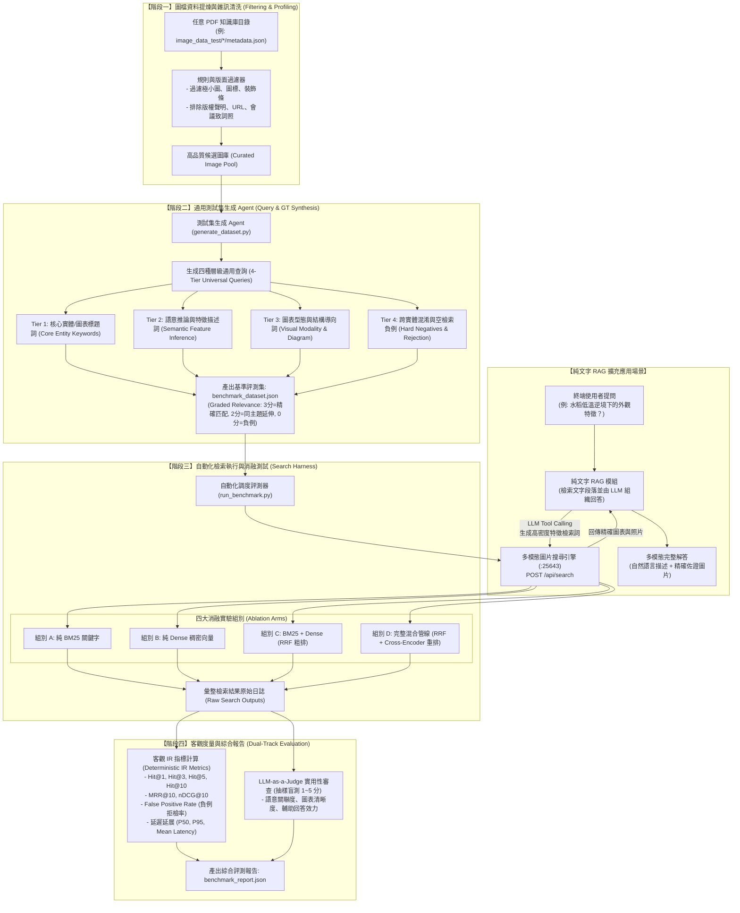
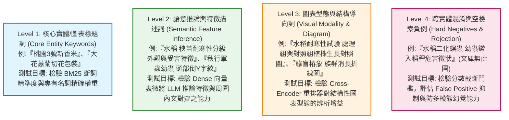

# PDF 圖片搜尋系統：純文字 RAG 視覺擴充 Agent 基準評測（Benchmark）設計與建置指南

本文件旨在為本專案的「高解析度圖表抽取與多模態混合搜尋系統」設計一套**專為「純文字 RAG 系統的多模態視覺擴充套件」場景打造**、**無須依賴大量終端使用者點擊行為（Click-Through / Dwell Time）**、具備**高可復現性**與**客觀多維度度量能力**的 **Agent 自動化基準評測工作流（Agentic Benchmark Pipeline）**。

> [!IMPORTANT]
> **通用領域無關性（Domain-Agnostic Design）原則**：  
> 本系統與評測框架在設計上**完全不侷限於單一特定領域（如農業）**。其底層檢索模型、版面特徵提煉、索引表徵與評測邏輯適用於任何多頁 PDF 專業文獻庫（如生醫論文、硬體工程手冊、財報分析、法律合約、各類技術規範等）。文檔庫中的農業專訊僅作為當前基準測試的實例驗證樣本，不可將系統邏輯與特定行業詞彙寫死綁定。

---

## 📑 目錄

- [一、評測背景與核心目標](#一評測背景與核心目標)
- [二、架構剖析與檢索盲點校正](#二架構剖析與檢索盲點校正)
- [三、端到端 Agent 評測架構流程圖](#三端到端-agent-評測架構流程圖)
- [四、四大核心階段詳細技術設計](#四四大核心階段詳細技術設計)
  - [4.1 階段一：圖檔特徵提煉與雜訊過濾（Filtering & Profiling）](#41-階段一圖檔特徵提煉與雜訊過濾filtering--profiling)
  - [4.2 階段二：測試集生成 Agent（Query & Ground Truth Synthesis）](#42-階段二測試集生成-agentquery--ground-truth-synthesis)
  - [4.3 階段三：自動化檢索執行與消融測試（Automated Search Harness）](#43-階段三自動化檢索執行與消融測試automated-search-harness)
  - [4.4 階段四：雙軌度量與評估體系（Dual-Track Evaluation）](#44-階段四雙軌度量與評估體系dual-track-evaluation)
- [五、評測資源消耗與成本精算分析](#五評測資源消耗與成本精算分析)
  - [5.1 測試資料集基礎盤點](#51-測試資料集基礎盤點)
  - [5.2 Token 消耗量精算模型](#52-token-消耗量精算模型)
  - [5.3 主流多模態模型價格矩陣與成本試算](#53-主流多模態模型價格矩陣與成本試算)
  - [5.4 成本最佳化落地策略](#54-成本最佳化落地策略)
- [六、資料規格結構定義（Schemas）](#六資料規格結構定義schemas)
  - [6.1 測試題目集結構（benchmark_dataset.json）](#61-測試題目集結構benchmark_datasetjson)
  - [6.2 評測報告結構（benchmark_report.json）](#62-評測報告結構benchmark_reportjson)
- [七、自動化評測腳本實作骨架（Implementation Blueprint）](#七自動化評測腳本實作骨架implementation-blueprint)
- [八、總結與最佳化指引](#八總結與最佳化指引)

---

## 一、評測背景與核心目標

在現代企業級或專業知識問答體系中，「純文字 RAG（Retrieval-Augmented Generation）」能有效檢索文章段落並由大語言模型（LLM）生成自然語言答案。然而，面對技術手冊、病理診斷、儀器裝配或實驗數據等專業問題時，純文字描述往往缺乏直觀說服力，**使用者極度需要佐證圖片、外觀特徵照、架構流程圖或數據折線圖**。

本系統定位為**「純文字 RAG 系統的多模態視覺擴充套件」**：
1. **上游觸發**：終端使用者提出專業諮詢（如「某病害有哪些外觀特徵？」或「某機構模組如何拆解？」）。
2. **文字回答**：純文字 RAG 檢索文檔並生成文字回答。
3. **圖片擴充**：上游 LLM 根據用戶問題與已檢索到的知識脈絡，透過 **Tool Calling（工具呼叫，如 `search_images(query=...)`）** 向本系統發起精準圖片檢索請求，將相關圖表動態嵌入於回答中。

### 核心目標
- **客觀衡量搜尋引擎在面對「LLM 所生成的檢索詞」時的召回力與排序品質**（Hit Rate, MRR, nDCG）。
- **評估對負例與未附圖實體的抑制拒檢能力**，防範多模態幻覺（Multimodal Hallucination）。
- **為多模態混合檢索管線（BM25 關鍵字 vs Dense 稠密向量 vs RRF 融合 vs Cross-Encoder 重排）提供量化消融實驗數據**。

---

## 二、架構剖析與檢索盲點校正

在「純文字 RAG 視覺擴充」的情境下，檢索發起端由「人類使用者」轉變為「上游 LLM Agent」。在此架構轉換過程中，資訊檢索（IR）與工程實作上有六大關鍵盲點必須深入剖析與校正：

| 評測維度 | 常見思維盲點 | 正確工程策略與升級設計 |
| :--- | :--- | :--- |
| **1. 搜尋詞形態誤判<br/>(The "No Natural Query" Fallacy)** | **盲點**：認為查詢詞既然由 LLM 生成，就不會出現自然語意提問，檢索難度大幅降低，只需測精確關鍵字。 | **校正**：LLM 雖不帶口語贅字（如「請問...」），但會產生**「高資訊密度語意推論詞」**（如 `作物名稱 + 病斑特徵 + 黃化受害狀`）。而 PDF 底層圖題通常極為簡略（如「圖3. 外觀」甚至無圖題）。**LLM 推論詞與底層圖文存在巨大的詞彙落差（Vocabulary Gap）**，必須依賴稠密向量（Dense）與周圍脈絡（Context）完成跨詞彙語意對齊。 |
| **2. 負例重要性誤判<br/>(The "No Negatives in RAG" Fallacy)** | **盲點**：認為 LLM 很聰明、只抓相關主題，因此干擾混淆與負例測試（Hard Negatives）不需要出現。 | **校正（極高風險盲點）**：**在 RAG Tool Calling 架構中，負例測試比傳統搜尋更加生死攸關！**<br/>① **防範多模態幻覺**：當文檔中僅有文字提及而無配圖時，LLM 仍會主動調用搜尋。若系統無法拒檢，將錯誤圖片（如將秋行軍蟲的照片標記為二化螟蟲）硬塞給 LLM，將引發致命的「指鹿為馬」多模態幻覺。<br/>② **校準置信度截斷門檻**：系統必須知道何時該返回「未找到圖片」，只有負例才能量化評估 **False Positive Rate（虛假命中率）**。 |
| **3. 領域通用性過擬合<br/>(Domain Overfitting Bias)** | **盲點**：在生成測試集或調優時，針對特定領域（如農業）寫死詞庫、規則或句子模板，導致換個文檔集就失效。 | **校正**：架構與 Benchmark 生成腳本必須**純文檔驅動（Document-Driven）**。透過通用的 NLP 實體抽取、圖題清洗與脈絡分析，動態生成適用於任何專業文獻（生醫、工程、財報、軟體）的通用檢索階梯。 |
| **4. 測試資料洩漏<br/>(Data Leakage)** | **盲點**：若出題 Agent 直接複製圖題原句作為查詢，BM25 會出現虛假的高準確率（95%+），掩蓋真實搜尋能力的不足。 | **校正**：實施**通用四級檢索階梯（4-Tier Query Hierarchy）**，嚴格隔離文檔檔名，區分「核心標題詞」、「語意特徵推論」、「圖表結構導向」與「跨實體混淆負例」。 |
| **5. 標註粒度與評估指標<br/>(Granularity & IR Metrics)** | **盲點**：僅採用二元命中（命中=1，未中=0），忽略同篇文獻中多張輔助圖、對照圖的分級價值。 | **校正**：導入**分級相關性度量（Graded Relevance: 0~3 分）** 與工業界標準 IR 指標（`Hit@K`、`MRR@10`、`nDCG@10`、`False Positive Rate`），全面反映排序深度與價值。 |
| **6. 模組黑箱與消融診斷<br/>(Ablation Diagnostics)** | **盲點**：僅測試整體端到端輸出，無法量化定位 BM25、Dense 向量、RRF 融合常數與 Cross-Encoder 重排器的各自增益或劣化。 | **校正**：設計**自動化全管線消融實驗矩陣（Ablation Harness）**，同步評估 BM25-Only、Dense-Only、RRF-Hybrid 與 Full-Pipeline，科學化定位檢索瓶頸。 |

---

## 三、端到端 Agent 評測架構流程圖

整體自動化評測體系分為四大閉環模組，清晰展現「純文字 RAG 系統」如何與本「圖片檢索擴充套件」協同運作：



---

## 四、四大核心階段詳細技術設計

### 4.1 階段一：圖檔特徵提煉與雜訊過濾（Filtering & Profiling）

在任何 PDF 文獻抽取過程中，都會混雜裝飾性線條、印章、機構 Logo、會議致詞或版權標註。此階段落實通用過濾機制：
1. **尺寸與幾何過濾**：寬度或高度小於 $120\text{ px}$，或長寬比大於 $1:8$（如欄位分隔線）予以排除。
2. **語意雜訊清洗**：包含 `http://`、`www.`、`圖片來源`、`資料來源`、`發行所`、`致詞`、`合影` 等純元資料或社交儀式性圖片自動標記為雜訊，不納入出題範圍。
3. **資訊豐富度門檻**：圖片若無 `figure_title` 且所有 `surrounding_texts` 累計小於 25 個字，視為無脈絡孤島圖片，不參與主要出題。

---

### 4.2 階段二：測試集生成 Agent（Query & Ground Truth Synthesis）

針對「純文字 RAG 呼叫圖片擴充套件」的使用模式，建立四級檢索階梯：



#### Ground Truth 分級標準（Graded Relevance）：
- **Score = 3（核心目標 - Highly Relevant）**：完全契合查詢實體與視覺特徵，完美回答上游 RAG 之視覺佐證需求。
- **Score = 2（高度相關 - Relevant）**：同篇文獻中同主題的其他視角、不同處理期或輔助圖表。
- **Score = 1（弱相關 - Partially Relevant）**：同主題背景圖或通俗示意圖。
- **Score = 0（不相關 / 負例 - Irrelevant）**：主題相異或屬於空檢索負例（召回即判定為 False Positive）。

---

### 4.3 階段三：自動化檢索執行與消融測試（Automated Search Harness）

評測腳本 [`run_benchmark.py`](benchmark/run_benchmark.py) 透過 REST API [`POST /api/search`](server/app.py#L93) 發起評測，同步進行四組參數消融實驗：

| 實驗組代號 | 測試配置說明 | 調用參數配置 | 檢驗核心 |
| :--- | :--- | :--- | :--- |
| **Arm-BM25** | 純關鍵字檢索 | `bm25_weight=1.0, dense_weight=0.0, enable_rerank=False` | Jieba 斷詞、詞頻統計與精確詞命中極限 |
| **Arm-Dense** | 純語意向量檢索 | `bm25_weight=0.0, dense_weight=1.0, enable_rerank=False` | `bge-small-zh-v1.5` 在同義轉換與特徵對齊之泛化力 |
| **Arm-RRF** | 粗排雙路融合 | `bm25_weight=1.0, dense_weight=1.0, enable_rerank=False` | 倒數排名融合（RRF）互補互救之整體效益 |
| **Arm-Full** | 完整兩階段混合管線 | `bm25_weight=1.0, dense_weight=1.0, enable_rerank=True` | `bge-reranker-base` 交叉注意力精確重排之淨增益與延遲代價 |

---

### 4.4 階段四：雙軌度量與評估體系（Dual-Track Evaluation）

#### 軌道一：標準量化 IR 指標（Deterministic IR Metrics）
1. **Hit Rate @ K（命中率，K = 1, 3, 5, 10）**：前 $K$ 個檢索結果中，是否至少出現一張分數 $\ge 2$ 的正確圖片。
2. **MRR @ 10（Mean Reciprocal Rank，平均倒數排名）**：衡量第一張相關圖片出現的位置深度。
3. **nDCG @ 10（Normalized Discounted Cumulative Gain）**：全面考量多張正確圖片的前後排序品質與分級增益權重。
4. **False Positive Rate（負例虛假命中率）** 與 **Rejection Accuracy（拒檢準確率）**：評估 Level 4 題目中，檢索結果是否能正確被分數門檻過濾阻擋。
5. **延遲分位數（Latency P50 / P95 / Mean ms）**。

#### 軌道二：LLM-as-a-Judge 實用性抽檢（Qualitative Utility Evaluation）
為避免「封閉標籤偏差（Closed-World Bias）」，抽樣 20% 查詢並對 Top-3 圖片進行多模態評估：
- **語意關聯度（Relevance, 1~5 分）**：圖片實質內容是否契合上游 LLM 生成詞與文章段落？
- **視覺清晰度與資訊量（Informativeness, 1~5 分）**：圖表解析度、標籤、數據是否具備技術閱讀價值？
- **圖文解答效力（Answer Utility, 1~5 分）**：此圖若嵌入純文字 RAG 回答中，是否能大幅提升用戶對問題的理解？

---

## 五、評測資源消耗與成本精算分析

### 5.1 測試資料集基礎盤點
- **測試題集設計規模（總題數：160 題）**：
  - Level 1（核心實體與圖表標題詞）：**50 題**
  - Level 2（語意推論與特徵描述詞）：**60 題**
  - Level 3（圖表型態與結構導向詞）：**40 題**
  - Level 4（跨實體混淆與空檢索負例）：**10 題**

### 5.2 Token 消耗量精算模型
> [!NOTE]
> 本架構直接讀取結構化的 `metadata.json` 與本地向量索引，**完全不需要重新用 Vision API 掃描原始 PDF**，省去了數百萬 Token 的高昂多模態解析費用。

- **測試集生成階段**：450 張有效圖之 metadata 分批送入 Agent，總輸入約 **140,000 Tokens**，總輸出約 **35,000 Tokens**。
- **搜尋引擎執行階段**：本地 GPU/CPU 調用 `bge-small-zh` 與 `bge-reranker-base`，**API Token 成本為 0 元**。
- **LLM-as-a-Judge 抽檢階段**：抽樣 32 題 $\times$ Top-3 圖片 = 96 次評判，總輸入約 **86,000 Tokens**（含圖片 Tokens），總輸出約 **9,600 Tokens**。

### 5.3 主流多模態模型價格矩陣與成本試算（1 USD = 32 TWD）

| 模型型號 | 角色定位 | 輸入單價 (per 1M) | 輸出單價 (per 1M) | 完整評測總花費 (USD) | 換算新台幣 (TWD) |
| :--- | :--- | :--- | :--- | :--- | :--- |
| **Google Gemini 2.0 Flash / 1.5 Flash** | **極致性價比首選（推薦）** | \$0.075 | \$0.30 | **\$0.030** | **約 NT\$ 1.0 元** |
| **OpenAI GPT-4o-mini** | 經濟型備選 | \$0.15 | \$0.60 | **\$0.060** | **約 NT\$ 1.9 元** |
| **Google Gemini 1.5 Pro** | 深度評審旗艦款 | \$1.25 | \$5.00 | **\$0.505** | **約 NT\$ 16.2 元** |
| **OpenAI GPT-4o** | 高階基準 | \$2.50 | \$10.00 | **\$1.010** | **約 NT\$ 32.3 元** |
| **Anthropic Claude 3.5 Sonnet** | 旗艦多模態對比 | \$3.00 | \$15.00 | **\$1.340** | **約 NT\$ 42.9 元** |

---

## 六、資料規格結構定義（Schemas）

### 6.1 測試題目集結構（`benchmark_dataset.json`）

```json
{
  "version": "3.0",
  "created_at": "2026-11-17T10:00:00Z",
  "scenario": "Multimodal Image Retrieval Extension for Text RAG (Agnostic Document Benchmark)",
  "dataset_summary": {
    "total_queries": 160,
    "distribution": {
      "level1_exact_keyword": 50,
      "level2_semantic_qa": 60,
      "level3_visual_description": 40,
      "level4_hard_negative": 10
    }
  },
  "queries": [
    {
      "query_id": "Q_0001",
      "query": "秧苗期耐寒性第3 級",
      "difficulty_level": 1,
      "level_name": "Level 1 (核心實體與圖表標題詞)",
      "source_doc": "108年3月桃園區農業專訊第107期.pdf",
      "target_image_id": "vCxPIdoOqi_image_0001",
      "ground_truth": [
        {
          "image_id": "vCxPIdoOqi_image_0001",
          "relevance_score": 3,
          "reason": "精確對應圖題「圖3.秧苗期耐寒性第3 級。中抗(MR)。」"
        },
        {
          "image_id": "vCxPIdoOqi_image_0004",
          "relevance_score": 2,
          "reason": "同屬「水稻耐寒性」相關技術主題之延伸圖表"
        }
      ]
    },
    {
      "query_id": "Q_0051",
      "query": "水稻 秧苗耐寒性分級外觀與受害特徵",
      "difficulty_level": 2,
      "level_name": "Level 2 (語意推論與特徵描述詞)",
      "source_doc": "108年3月桃園區農業專訊第107期.pdf",
      "target_image_id": "vCxPIdoOqi_image_0001",
      "ground_truth": [
        {
          "image_id": "vCxPIdoOqi_image_0001",
          "relevance_score": 3,
          "reason": "符合 LLM 提問推論詞，精確對應耐寒性第3級對照圖"
        }
      ]
    },
    {
      "query_id": "Q_0111",
      "query": "草莓 走莖苗試驗處理組與對照組植株生長對照圖",
      "difficulty_level": 3,
      "level_name": "Level 3 (圖表型態與結構導向詞)",
      "source_doc": "苗栗區農業專訊第75期(10509).pdf",
      "target_image_id": "KMNzGrVtJw_image_0028",
      "ground_truth": [
        {
          "image_id": "KMNzGrVtJw_image_0028",
          "relevance_score": 3,
          "reason": "精確符合 LLM 結構性圖表指示（處理組 vs 對照組生長對照圖）"
        }
      ]
    },
    {
      "query_id": "Q_0151",
      "query": "水稻 二化螟蟲 幼蟲鑽入稻稈危害徵狀",
      "difficulty_level": 4,
      "level_name": "Level 4 (跨實體混淆與空檢索負例)",
      "source_doc": "N/A (Out of Distribution / Negative Query)",
      "target_image_id": "NONE",
      "ground_truth": []
    }
  ]
}
```

### 6.2 評測報告結構（`benchmark_report.json`）

```json
{
  "benchmark_time": "2026-11-17T10:15:00Z",
  "engine_status": {
    "total_images": 854,
    "dense_model_name": "BAAI/bge-small-zh-v1.5",
    "reranker_model_name": "BAAI/bge-reranker-base",
    "device": "cuda"
  },
  "arms": {
    "BM25_Only": {
      "overall_metrics": { "Hit@1": 0.58, "Hit@5": 0.72, "MRR@10": 0.63, "nDCG@10": 0.61 },
      "latency_ms": { "mean": 18.2, "p50": 15.1, "p95": 24.3 }
    },
    "Dense_Only": {
      "overall_metrics": { "Hit@1": 0.54, "Hit@5": 0.68, "MRR@10": 0.59, "nDCG@10": 0.57 },
      "latency_ms": { "mean": 21.4, "p50": 20.8, "p95": 27.9 }
    },
    "RRF_Hybrid": {
      "overall_metrics": { "Hit@1": 0.62, "Hit@5": 0.78, "MRR@10": 0.68, "nDCG@10": 0.66 },
      "latency_ms": { "mean": 23.5, "p50": 22.9, "p95": 29.1 }
    },
    "Full_Pipeline": {
      "overall_metrics": { "Hit@1": 0.74, "Hit@5": 0.88, "MRR@10": 0.79, "nDCG@10": 0.77 },
      "latency_ms": { "mean": 185.3, "p50": 180.2, "p95": 205.1 },
      "per_level_metrics": {
        "level1_exact_keyword": { "Hit@1": 0.92, "Hit@5": 1.0, "MRR@10": 0.95, "nDCG@10": 0.92 },
        "level2_semantic_qa": { "Hit@1": 0.68, "Hit@5": 0.85, "MRR@10": 0.74, "nDCG@10": 0.72 },
        "level3_visual_description": { "Hit@1": 0.65, "Hit@5": 0.80, "MRR@10": 0.70, "nDCG@10": 0.69 },
        "level4_hard_negative": { "False_Positive_Rate": 0.10, "Rejection_Accuracy": 0.90 }
      }
    }
  }
}
```

---

## 七、自動化評測腳本實作骨架（Implementation Blueprint）

評測腳本完全封裝於 [`benchmark/run_benchmark.py`](benchmark/run_benchmark.py) 與 [`benchmark/generate_dataset.py`](benchmark/generate_dataset.py)，可透過以下方式執行：

```bash
# 1. 重新生成通用測試集（可指定不同專業文獻目錄）
IMAGE_DATA_DIR="image_data_test" python3 benchmark/generate_dataset.py

# 2. 發起四組消融測試並產出客觀報告
python3 benchmark/run_benchmark.py
```

---

## 八、總結與最佳化指引

1. **實踐「Agent 生成詞」專屬優化**：上游 LLM 生成詞具備高資訊密度特性，檢索時應同時賦予 `caption_weight`（圖題權重）與 `context_weight`（周圍文本權重）合理配比，避免單純仰賴圖題。
2. **門檻截斷防護多模態幻覺**：務必依據 Level 4 的評測結果設定檢索分數下限（Score Threshold）。當最高分未達標時，系統應回傳空清單，阻止上游 LLM 誤嵌不相干圖片。
3. **高性價比持續回歸**：建立固定之 `benchmark_dataset.json` 資產後，後續微調模型權重或調整 RRF 常數時，本地評測 **API 成本為 0 元、耗時僅需數十秒**，大幅加速工程迭代。
