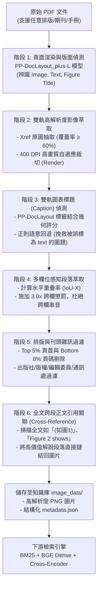

# PDF 多模態影像知識庫建構模組 (PDF Multimodal Knowledge Extractor)

本目錄 (`core/converter/`) 為整個多模態檢索系統的**核心資料庫建置引擎**。它的核心任務是：**將任意非結構化、多版面（單欄/雙欄/三欄）的 PDF 文獻，全自動轉換為高品質、具備豐富上下文語意（Context-Aware）的多模態圖文知識庫 (`image_data/`)**。

這套轉換機制專為解決真實世界文獻（學術論文、農業專訊、工程手冊、政府出版品等）常見的排版痛點而設計，完全不依賴高昂的外部商業多模態 API（如 GPT-4V），在純本地算力下即可達成高精準度的圖文解構。

---

## 目錄

1. [系統整體架構與流程圖](#1-系統整體架構與流程圖)
2. [六大核心技術機制與演算法細節](#2-六大核心技術機制與演算法細節)
   - [階段一：頁面高精度光柵化與版面分析 (Layout Detection)](#階段一頁面高精度光柵化與版面分析-layout-detection)
   - [階段二：雙軌高解析度圖片萃取 (Xref vs. 400 DPI Render)](#階段二雙軌高解析度圖片萃取-xref-vs-400-dpi-render)
   - [階段三：雙軌圖表標題 (Caption) 偵測與正則回退機制](#階段三雙軌圖表標題-caption-偵測與正則回退機制)
   - [階段四：多欄位感知段落關聯 (Column-Aware Surrounding Texts)](#階段四多欄位感知段落關聯-column-aware-surrounding-texts)
   - [階段五：排版與刊頭/版權雜訊過濾 (Masthead & Noise Filtering)](#階段五排版與刊頭版權雜訊過濾-masthead--noise-filtering)
   - [階段六：全文跨段正文引用關聯 (Cross-Reference Resolution)](#階段六全文跨段正文引用關聯-cross-reference-resolution)
3. [資料庫輸出規範 (`metadata.json` Schema)](#3-資料庫輸出規範-metadatajson-schema)
4. [CLI 指令操作與斷點續傳機制](#4-cli-指令操作與斷點續傳機制)
5. [Demo 展示講述框架 (Talking Points & Q&A)](#5-demo-展示講述框架-talking-points--qa)

---

## 1. 系統整體架構與流程圖

整個萃取與建庫流程由 `build_database.py` 驅動，內部由 `PdfInfo` 協調各階段的演算法：



---

## 2. 六大核心技術機制與演算法細節

### 階段一：頁面高精度光柵化與版面分析 (Layout Detection)
- **檔案**：`core/converter/__init__.py` (`to_images`, `label_layout`)
- **機制**：
  1. 使用 PyMuPDF 將 PDF 每頁以指定 DPI (預設 100~300 DPI) 渲染為標準 RGB 點陣圖，消除 PDF 中各異的字型編碼與嵌入物件差異。
  2. 載入 SOTA 文件版面分析模型 `PP-DocLayout_plus-L`，針對頁面進行區域分割，偵測出包括 `image`、`figure_title`、`text`、`table` 等元素的邊界方框（Bounding Box）。
  3. 採用快取單例模式 (`PdfInfo._layout_model`)，避免每份 PDF 重複載入模型權重。

---

### 階段二：雙軌高解析度圖片萃取 (Xref vs. 400 DPI Render)
- **檔案**：`core/converter/__init__.py` (`label_images`, `match_xref_for_rect`)
- **解決痛點**：PDF 內的圖片有的以原始點陣圖嵌入（如 JPEG/PNG），有的則為向量圖或被透明遮罩裁切。若一律用固定截圖會失真模糊；若一律用 Xref 會抓到拼貼碎圖。
- **雙軌自適應策略**：
  1. **軌道 A (Xref 原圖萃取)**：計算頁面內部嵌入之點陣圖 xref 與版面方框的交集面積比率（Coverage）。若 `Coverage ≥ 0.6`，直接無損萃取原始二進位影像，保留百萬像素原貌。
  2. **軌道 B (400 DPI 自適應渲染裁切)**：若無對應點陣圖（例如純向量繪製、複合圖表或 Coverage 不足），自動切換至 400 DPI 超高解析度矩陣渲染剪裁，確保圖表文字清晰可見。

---

### 階段三：雙軌圖表標題 (Caption) 偵測與正則回退機制
- **檔案**：`core/converter/img_data.py`、`core/converter/tools/text_validation.py`
- **解決痛點**：
  - 傳統啟發式搜尋半徑過小（如只看 5% 對角線長度），只要版面略有留白即判定無圖題。
  - 版面偵測模型常將短標題（如「圖 1. 水稻白枯心」）誤分類為普通段落 `text`，導致標題欄位空缺。
- **解決方案：雙軌評分與正則回退**：
  1. **搜尋半徑放寬**：將幾何搜尋範圍擴展至圖片對角線的 `22%`，覆蓋上下留白。
  2. **多語系 Caption 正則特徵判斷 (`is_caption_pattern`)**：
     ```python
     # 支援中文、英文、羅馬數字、編號帶後綴等標準格式
     pattern = r"^\s*(?:圖|表|附圖|附表|照片|Figure|Fig\.?|Plate|Photo|Table)\s*([0-9]+|[一二三四五六七八九十]+|[IVXLCDM]+)..."
     ```
  3. **幾何加權評分矩陣**：
     - 若段落符合 Caption 正則特徵：`+15.0 分`
     - 若模型標籤為 `figure_title`：`+8.0 分`
     - 若位於圖片正下方且水平重疊率 $\ge 0.25$：`+6.0 分`
     - 若位於圖片正上方且水平重疊率 $\ge 0.25$：`+3.0 分`
     - 距離衰減懲罰：$- \frac{d}{\text{diagonal}} \times 10.0$
  4. **選定標題後自動互斥**：被選為 Caption 的文字塊自動從候選周圍段落中剔除，絕不重複。

---

### 階段四：多欄位感知段落關聯 (Column-Aware Surrounding Texts)
- **檔案**：`core/converter/distance.py` (`column_aware_distance`, `horizontal_overlap_ratio`)
- **解決痛點**：在雙欄或三欄排版中，左欄圖片的右邊緣距離右欄頂部文字可能只有 20 像素，而距離左欄下方的正文卻有 30 像素。純歐氏距離排序會導致**跨欄誤抓（Cross-Column Bleed）**，將右欄無關文字灌入左欄圖片的上下文。
- **演算法公式**：
  1. 計算圖片方框與文字方框在 X 軸上的重疊比例（IoU-X-min）：
     $$\text{Overlap}_x = \frac{\max(0, \min(x_{2}^{img}, x_{2}^{txt}) - \max(x_{1}^{img}, x_{1}^{txt}))}{\min(w_{img}, w_{txt})}$$
  2. 若 $\text{Overlap}_x \ge 0.25$，認定為同欄排版，距離為正常幾何距離：
     $$D = \sqrt{\Delta x^2 + \Delta y^2}$$
  3. 若 $\text{Overlap}_x < 0.25$（表示段落位於不同欄位，水平錯開），對水平距離施加 **3.0 倍強懲罰**：
     $$D_{penalized} = \sqrt{(3.0 \times \Delta x)^2 + \Delta y^2}$$
  4. 實測結果：徹底解決多欄文獻中的跨欄文字干擾問題，確保關聯的段落絕對屬於同欄脈絡。

---

### 階段五：排版與刊頭/版權雜訊過濾 (Masthead & Noise Filtering)
- **檔案**：`core/converter/tools/text_validation.py` (`is_masthead_or_metadata`, `is_page_number_or_header`)
- **解決痛點**：期刊、專訊或政府報告的頁首或頁尾經常出現出版機關、發行人、編輯委員名單、通訊地址與單純頁碼。當圖片位於頁面底部時，傳統距離法常將整塊版權宣告當成圖片說明！
- **過濾機制**：
  1. **邊界防護網 (Boundary Filtering)**：
     - 自動忽略頁首 Top 5%（頁面眉批、卷號條）
     - 自動忽略頁尾 Bottom 8%（頁碼、版次資訊）
  2. **版面刊頭語意特徵過濾 (`is_masthead_or_metadata`)**：
     - 監控特徵詞：`發行人`、`總編輯`、`編輯委員`、`出版機關`、`印刷所`、`版權所有`、`ISSN`、`ISBN`、`GPN`、`All rights reserved` 等。
     - 若命中 $\ge 2$ 個刊頭特徵詞，或命中 1 個特徵詞並附帶電話/傳真/地址，立即判定為刊印雜訊並剔除。
  3. **頁碼與極短字元過濾 (`is_page_number_or_header`)**：
     - 正則排除純數字、`Page 12`、`- 12 -`、`第 12 頁` 等無意義標籤。

---

### 階段六：全文跨段正文引用關聯 (Cross-Reference Resolution)
- **檔案**：`core/converter/__init__.py` (`resolve_cross_references`)
- **解決痛點**：**圖題過簡 (Caption Brevity Gap)**。
  - 圖片底下的圖題通常極其簡短，例如只有「`圖 1. 二化螟幼蟲`」。
  - 但是對該害蟲的病徵描述（「水稻分櫱期造成白枯心、孕穗期造成白穗」）往往寫在**本文其他頁面或遙遠段落**中，並附註 `(如圖1)` 或 `如圖 1 所示`。
  - 若僅抓取圖片周圍 3 個文字塊，搜尋「白枯心特徵」時將永遠找不到這張二化螟圖片！
- **解決方案：全文圖表引用反向鏈結**：
  1. 系統自動從已提取的圖題中解析圖表前綴與編號（如 `prefix="圖"`, `number="1"`）。
  2. 掃描整本 PDF 所有頁面的正文區塊（Text Blocks），以預先編譯之正則表達式檢索引用特徵：
     - 括弧引用：`[（\(].*?圖\s*1\b.*?[）\)]`
     - 動詞引用：`如圖\s*1\s*所示`、`見圖\s*1`、`詳見圖\s*1`
     - 主詞描述：`圖\s*1\s*(為|顯示|表示|呈現)`、`Figure 1 shows`
  3. 當命中引用且確認非圖題本身時，格式化為：
     ```text
     [正文引用 第1頁] 二化螟幼蟲於分櫱期蛀入稻株造成分櫱期白枯心(如圖1)，孕穗期白穗。
     ```
  4. 自動將此引用段落同時加入圖片的 `cross_references` 與 `surrounding_texts`。
  5. **效益**：無需耗費額外 Token 或昂貴的大型多模態模型，即可將跨頁面、跨段落的深層知識完美歸納至圖片索引中！

---

## 3. 資料庫輸出規範 (`metadata.json` Schema)

執行轉換後，每個 PDF 會在 `image_data/<pdf_uid>/image_datas/` 產生以下結構：

```
image_data/<pdf_uid>/image_datas/
├── image_0000.png
├── image_0001.png
└── metadata.json
```

`metadata.json` 的 JSON 格式如下：

```json
{
    "name": "rice_protection_guide.pdf",
    "uid": "a1b2c3d4-e5f6-7890",
    "imgs": [
        {
            "name": "image_0000",
            "page": 2,
            "coordinate": [120.0, 340.5, 580.0, 710.2],
            "figure_title": "圖 1. 二化螟為害水稻分櫱期造成之白枯心",
            "surrounding_texts": [
                "二化螟在台灣每年發生4至5世代，幼蟲鑽入稻株基部危害，嚴重影響分櫱與產量。",
                "防治藥劑應於卵孵化盛期施用，以確保藥液能接觸幼蟲。",
                "[正文引用 第1頁] 水稻分櫱期常受二化螟幼蟲蛀蝕造成白枯心(如圖1)，孕穗期則形成白穗無法結實。"
            ],
            "cross_references": [
                "[正文引用 第1頁] 水稻分櫱期常受二化螟幼蟲蛀蝕造成白枯心(如圖1)，孕穗期則形成白穗無法結實。"
            ]
        }
    ]
}
```

### 與下游檢索系統的無縫對接
下游 `core/data_loader.py` 與 `core/models.py` 會自動讀取 `metadata.json`：
- `figure_title` 會自動被赋予更高權重（在 BM25 索引中重複兩次，在 Dense 模型中作為 Primary Caption）。
- `surrounding_texts`（包含本頁周圍段落與跨頁引用段落）會組裝成 `context_text` 與 `full_text`，提供 Cross-Encoder 重排序模型進行深度語意比對。

---

## 4. CLI 指令操作與斷點續傳機制

整個建置過程由專屬 CLI 工具 `build_database.py` 控制。

### 基本指令

```bash
# 1. 建立知識庫（指定來源 PDF 資料夾與輸出目標）
python build_database.py -s /path/to/raw_pdfs -o image_data

# 2. 指定頁面渲染解析度與高畫質截圖解析度
python build_database.py -s /path/to/raw_pdfs -o image_data --dpi 300 --optimize-dpi 400

# 3. 強制使用 CPU 執行 (適用於未配置 GPU 之環境)
python build_database.py -s /path/to/raw_pdfs -o image_data --no-gpu

# 4. 手動指定 GPU 設備 (例如指定使用 RTX A6000 第一張卡)
python build_database.py -s /path/to/raw_pdfs -o image_data --gpu-id 0

# 5. 測試階段：僅處理前 5 份 PDF
python build_database.py -s /path/to/raw_pdfs -o image_data --limit 5
```

### 多顯卡相容性與自動架構遮蔽 (GPU Auto-Compatibility)
- **問題背景**：當前官方 PaddlePaddle 預編譯版本支援的最高 CUDA 架構為 SM 9.0 (Hopper)。若伺服器同時安裝有極新架構顯卡 (例如 NVIDIA Blackwell 12.0 / RTX 50 系列 / B200)，直接啟動會引發 `RuntimeError: Unsupported GPU architecture`。
- **自適應防護**：本系統已內建 `core/converter/gpu_config.py`，啟動時會透過 `nvidia-smi` 自動探測所有顯卡架構，**自動排除 > SM 9.0 的顯卡，並精準鎖定系統中的 RTX A6000 (SM 8.6) 進行全速 GPU 加速**。使用者無需手動配置 `CUDA_VISIBLE_DEVICES`，開箱即用。

### 斷點續傳機制 (Fault-Tolerant Resuming)
- 系統會在輸出資料夾中自動維護 `processed_docs.json`。
- 每處理完 5 份文件（可透過 `--save-interval` 調整）或在使用者按下 `Ctrl+C` 中斷時，系統會**原子性寫入 (Atomic Write)** 進度清單。
- 下次重新啟動同一個指令時，系統會自動跳過已建庫的文件，絕不重複浪費運算資源。

---

## 5. Demo 展示講述框架 (Talking Points & Q&A)

當你在展示或向主管、評審 Demo 本系統時，可依照下列節奏進行說明：

### 🎯 30 秒電梯簡報 (Elevator Pitch)
> 「我們這套系統是為了解決真實世界 PDF 圖文檢索的痛點。市面上的工具通常只能把圖片粗暴地截下來，卻遺失了圖片與文字的上下文關聯。我們設計了一套**自適應版面多模態解構管線**，透過版面分析、雙軌 Caption 挽救、多欄位感知，以及創新的『全文跨段引用關聯』技術，讓圖片能自動吸納整個文章中解釋它的精華段落。**完全不需要昂貴的 GPT-4V API，在本地就能實現高品質的多模態圖文對齊**。」

---

### 💡 2 分鐘架構深訪 (Deep Dive Highlights)

1. **為什麼不直接用 PyMuPDF 截圖就好？**
   - *答*：直接截圖無法判斷「哪一段字是這張圖的標題或說明」。而且許多 PDF 的圖片是由數十個向量片段或小圖示組成，直接萃取只會拿到零碎的破圖。我們使用 `PP-DocLayout_plus-L` 先精確定位語意圖像區域，再動態以 400 DPI 高畫質自適應還原。

2. **多欄位排版怎麼避免抓錯文字？**
   - *答*：學術論文與雜誌常是雙欄或三欄。如果只算最短直線距離，左欄圖片旁邊的右欄文字會因為距離太近而被誤抓。我們設計了 `column_aware_distance`，計算水平重疊率 (IoU-X)，只要沒有重疊就施加 3 倍位移懲罰，確保關聯的文字 100% 來自同一欄位脈絡。

3. **如果圖題只寫「圖1」，系統怎麼知道這張圖在畫什麼？**
   - *答*：這就是我們最強大的**『全文正文引用關聯 (Cross-Reference Resolution)』**。我們會反向檢索整篇文獻中所有提到「如圖1」、「見圖 1 所示」的正文段落，把作者在文章裡詳細說明的病徵、實驗條件和觀察結論，自動關聯回這張圖片。這徹底消除了「縮略圖題缺乏特徵」的檢索死角。

4. **很多文獻底部的版權頁、發行人名單會不會干擾檢索？**
   - *答*：我們內建了排版邊界過濾（剔除 Top 5% 眉批與 Bottom 8% 頁尾）與刊頭特徵過濾（自動攔截發行人、編輯委員、出版單位、傳真電話等刊印雜訊），保證知識庫的純淨度，避免檢索時搜出雜訊。

